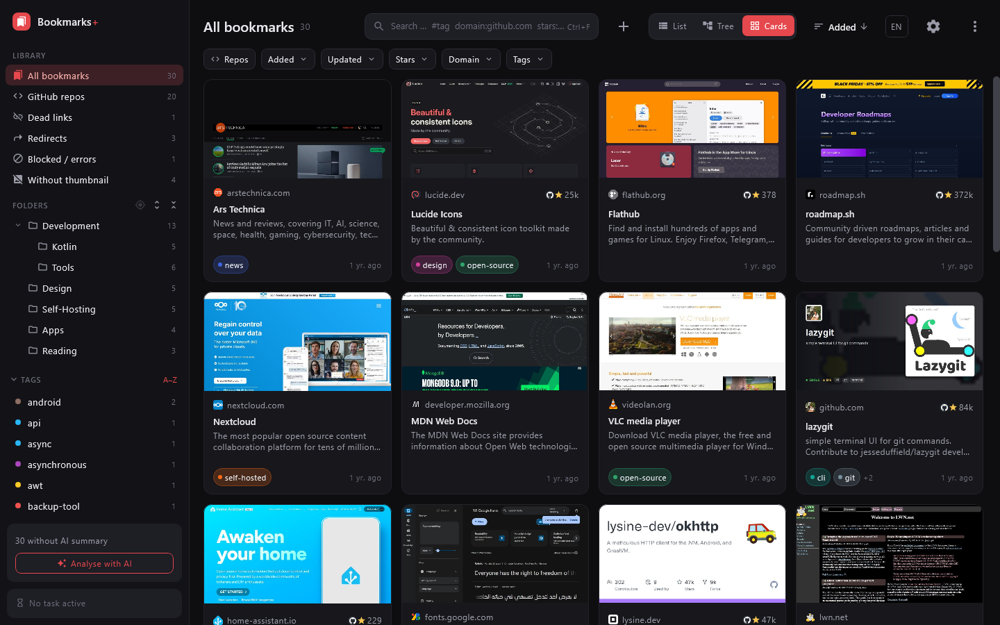
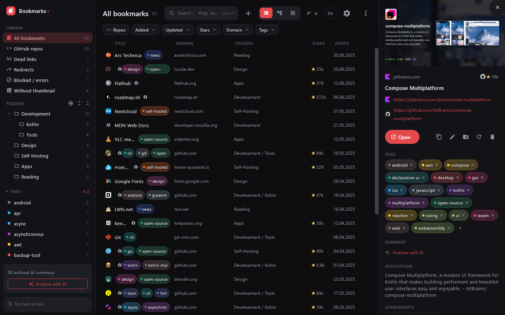
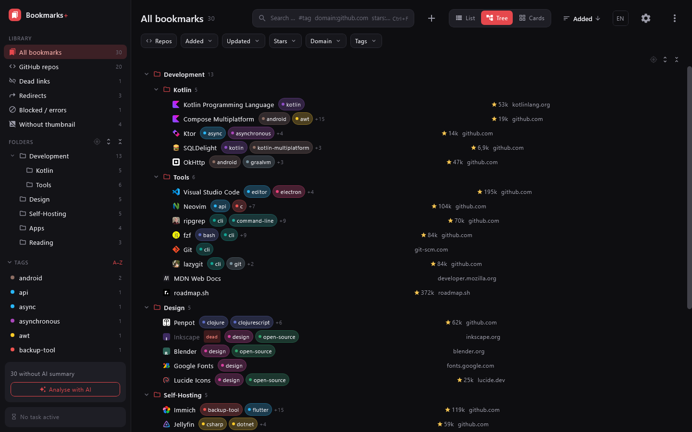
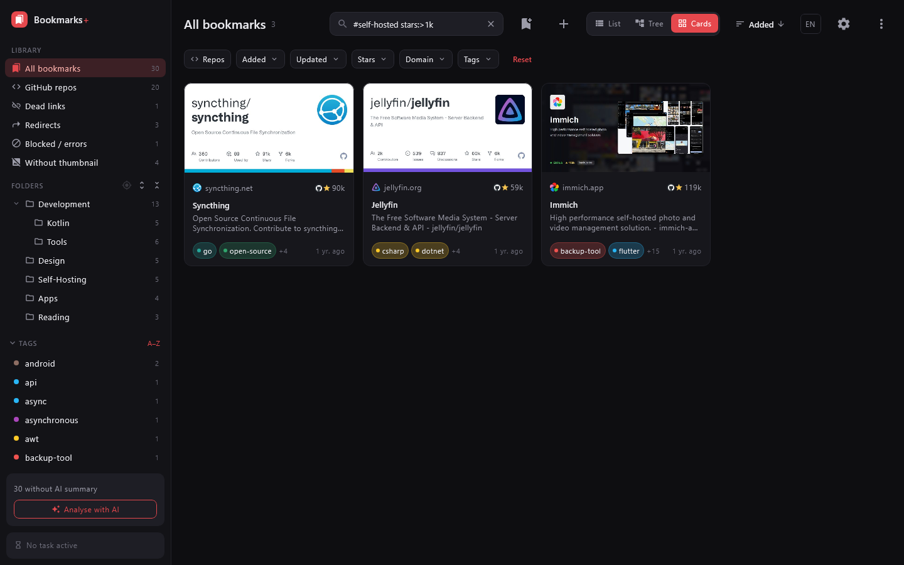
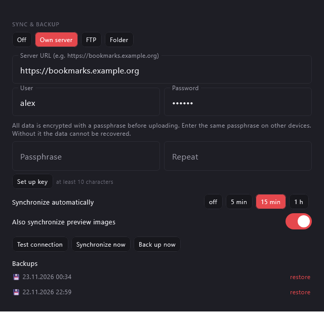
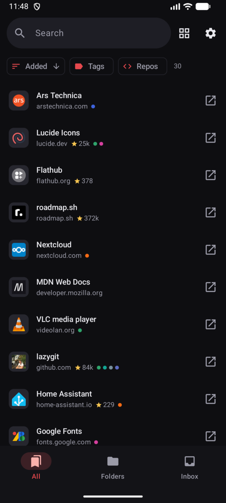
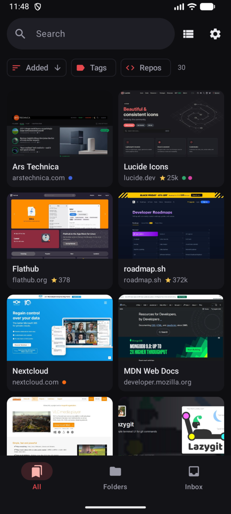
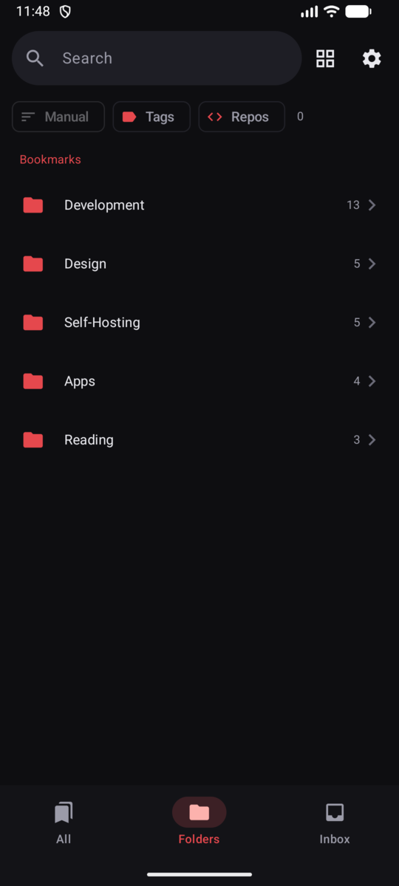
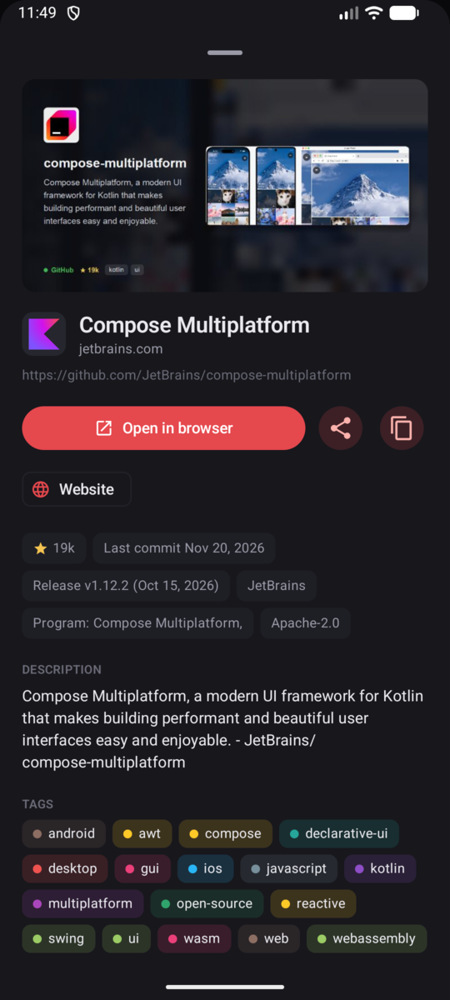
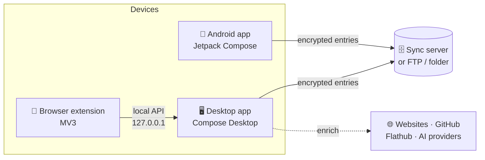

<p align="center">
  
</p>

<h1 align="center">Bookmarks Plus</h1>

<p align="center"><b>🇬🇧 English</b> · <a href="README_DE.md">🇩🇪 Deutsch</a></p>

<p align="center">
  <b>Order for thousands of bookmarks.</b><br>
  A fast, local bookmark manager with preview images, GitHub data, AI summaries<br>
  and end-to-end encrypted sync for desktop, Android and the browser.
</p>

<p align="center">
  
  
  <a href="https://github.com/TobseF/Bookmarks-Plus/actions/workflows/build.yml"></a>
  
  
  
  <a href="LICENSE"></a>
</p>

<p align="center">
  
</p>

---

Browser bookmarks quickly hit their limits: no previews, no tags, sluggish with a few thousand entries, and every link lives in exactly one folder. **Bookmarks Plus** is a native app that searches and filters 6,000 bookmarks in milliseconds. It enriches every page locally and keeps everything in sync between your own devices – without any server being able to read the contents.

## Features

<table>
<tr>
<td width="50%" valign="top">

### 🗂️ Organize
- **Folders and links:** a bookmark can live in any number of folders.
- **Colored tags**, Inbox, trash, saved searches
- **Three views:** cards, list and tree
- Multi-selection, drag & drop, keyboard shortcuts
- Import/export in Netscape HTML format: **byte-exact compatible** with Chrome and Vivaldi
- User interface in **English and German**

</td>
<td width="50%" valign="top">

### 🔍 Find
- Search in **milliseconds** across title, URL, description and **full text** (README, page text, summary)
- **Relevance ranking:** title before folder path before tags before other fields; whole words, matching case and the display language first. Finds **folders** too (toggle: both, bookmarks, folders)
- **Operators:** `#tag` `domain:github.com` `stars:>1k` `added:2024` `is:repo` `is:dead` `-word` …
- Filter by added, updated, stars, domain and tags

</td>
</tr>
<tr>
<td valign="top">

### ✨ Enrich
- **Preview image** of every page, rendered locally with headless Chrome, **cookie banners are hidden**
- **Share images** (`og:image`) as cards, favicons, metadata
- **GitHub:** stars, last commit, release, author/organization, the complete **README**, official website
- **Programs:** platforms, license, package IDs (winget, brew …), Flathub and AlternativeTo data

</td>
<td valign="top">

### 🤖 AI (optional)
- AI title, description and **summary** in English and German
- Suggestions for **tags** and **target folders**, applied one by one or for many bookmarks at once
- **OpenRouter**, **nano-gpt** or your own base URL (Ollama, LM Studio)
- Your own API key, costs per run always in view

</td>
</tr>
<tr>
<td valign="top">

### 🧹 Clean up
- Find and merge **duplicates**
- **Link check:** dead, redirect, bot protection, with a Web Archive link
- Switch addresses to **https**
- Trash with restore

</td>
<td valign="top">

### 🔐 Sync and security
- **End-to-end encrypted** (Argon2id + AES-256-GCM) **per bookmark**
- Target: **own server** (Docker), **FTP/FTPS** or a cloud folder
- The server only sees opaque UUIDs, revision and timestamp. It detects **conflicts** by itself.
- Encrypted **export** as one file or as one file per entry

</td>
</tr>
</table>

## Screenshots

| List with detail pane | Folder tree |
|---|---|
|  |  |
| **Search with operators** | **Sync settings** |
|  |  |

**Android**

<p>
  
  
  
  
</p>

<sub>All screenshots show the demo collection from <a href="docs/demo/demo-bookmarks-en.html"><code>docs/demo/demo-bookmarks-en.html</code></a>, enriched by the app itself.</sub>

## Components

| | Component | Purpose | Docs |
|---|---|---|---|
| 🖥️ | **Desktop app** | Main application for Windows and Linux: collect, sort, enrich, AI, sync | [desktop/README.md](desktop/README.md) |
| 📱 | **Android app** | View, search, open in the browser, put links into the Inbox via *Share* | [android/README.md](android/README.md) |
| 🗄️ | **Sync server** | Ktor server for the encrypted sync, available as a Docker image | [server/README.md](server/README.md) |
| 🧩 | **Browser extension** | Chrome, Vivaldi, Edge, Brave: save, side panel, search in the address bar | [extension/README.md](extension/README.md) |

Shared modules:

| Module | Contents |
|---|---|
| `shared` | Kotlin Multiplatform: data model, SQLDelight schema, Netscape import/export, filters and search, translations (`i18n`) |
| `enrich` | Page fetching, screenshots (Playwright), cookie banners, GitHub, Flathub, AlternativeTo, AI client |
| `sync` | Encryption, entry-level sync engine, server/FTP/folder targets, export/import, backups |



## Quick start

**Install:** the current packages are available on the [Releases](https://github.com/TobseF/Bookmarks-Plus/releases) page.

| System | File |
|---|---|
| Windows | `BookmarksPlus-<version>-windows-x64.msi` (installer) or `…-portable.zip` |
| Linux | `bookmarks-plus_<version>_amd64.deb` or `…-linux-x64.tar.gz` |
| Android | `BookmarksPlus-<version>.apk` |
| Server | Docker image or `bookmarks-plus-server-<version>.zip` |

**Get going:**

1. Start the desktop app, ⚙ → *Maintenance* → **Import HTML** (export from your browser).
2. Start the enrichment. Preview images and GitHub data are loaded in the background.
3. Optional: add an AI provider, set up the [sync server](server/README.md), connect the [Android app](android/README.md) and the [browser extension](extension/README.md).

**Language:** all apps start in English. Switch to German in the settings of each app – desktop: ⚙ → *Appearance* → *Language*; Android: *Settings* → *Appearance*; extension: options page; server: environment variable `BMP_LANG=de`.

## Building from source

You need JDK 17 or newer. Gradle downloads the JDK 22 required by the toolchain on its own. For Android you additionally need the Android SDK (API 36).

```bash
git clone https://github.com/TobseF/Bookmarks-Plus.git
cd Bookmarks-Plus

./gradlew :desktop:run                 # start the desktop app
./gradlew :android:assembleDebug       # Android APK
./gradlew :server:installDist          # server (server/build/install/)
./gradlew test                         # tests (Android tests need the SDK)
```

Stack: Kotlin 2.4, Compose Multiplatform 1.12, SQLDelight 2.4 (SQLite + FTS5), Ktor 3, Playwright, BouncyCastle (Argon2id), Gradle 9.

### Translations

| Part | Files |
|---|---|
| Desktop app and shared modules | `*/src/main/resources/i18n/<bundle>.properties` (English) and `<bundle>_de.properties` (German) |
| Android app | `android/src/main/res/values/strings_ui.xml` and `values-de/strings_ui.xml` |
| Browser extension | `extension/_locales/en/messages.json` and `_locales/de/messages.json` |
| Server | `server/src/main/resources/i18n/server.properties` and `server_de.properties` |

## CI/CD

The GitHub Actions workflow ([`.github/workflows/build.yml`](.github/workflows/build.yml)) builds on every push to `main` and on pull requests. A tag of the form `v1.2.3` additionally creates a release:

```bash
git tag v1.0.0 && git push origin v1.0.0
```

| Job | Result |
|---|---|
| `test` | all JVM tests (shared, sync, server, enrich, desktop) |
| `desktop-windows` | MSI installer and portable ZIP |
| `desktop-linux` | `.deb` and portable `tar.gz` |
| `android` | signed release APK |
| `server` | server ZIP |
| `docker` | build the server image and push it to GHCR and, with Docker Hub secrets, to Docker Hub: `edge` from the main branch, `<version>` and `latest` for releases |
| `release` | GitHub release with all files and automatic release notes |

The results of every run are attached to the workflow run as artifacts.

**Secrets** (*Settings → Secrets and variables → Actions → Secrets*):

| Secret | Required | Contents |
|---|---|---|
| `ANDROID_KEYSTORE_BASE64` | for signed APKs | keystore as Base64 (`base64 -w0 release.jks`) |
| `ANDROID_KEYSTORE_PASSWORD` | with keystore | password of the keystore |
| `ANDROID_KEY_ALIAS` | with keystore | alias of the key |
| `ANDROID_KEY_PASSWORD` | optional | password of the key, if different from the keystore password |
| `DOCKER_USERNAME` | Docker Hub only | registry user; if set, the image is also pushed there |
| `DOCKER_PASSWORD` | Docker Hub only | registry access token |

**Variables** (same page, *Variables* tab):

| Variable | Required | Contents |
|---|---|---|
| `DOCKER_IMAGE` | optional | image name on Docker Hub, default `<DOCKER_USERNAME>/bookmarks-plus-server`. The image always goes to `ghcr.io/tobsef/bookmarks-plus-server` as well |
| `DOCKER_REGISTRY` | optional | registry host for a custom target, default `docker.io` |

Without Android secrets the APK is signed with the debug key and the run shows a warning. The GitHub Container Registry and the release use the built-in `GITHUB_TOKEN`, no secrets needed. An image on GHCR is private at first and can be made public under *Packages → Package settings*.

## Privacy

- All data stays local (`~/.bookmarks-plus`). There is no account, no forced cloud and no telemetry.
- The sync is end-to-end encrypted. A stolen server data set reveals neither addresses nor titles, tags or folders.
- API keys and passwords are stored protected (Windows: DPAPI).
- AI is optional and uses your own key with the provider of your choice. With Ollama or LM Studio nothing leaves your computer.

## Project status

Started as a personal tool for a collection of about 6,000 bookmarks. Planning and decisions are documented (in German) in [docs/PLAN.md](docs/PLAN.md), the model selection for the AI in [docs/AI-MODELLE.md](docs/AI-MODELLE.md).

## License

[MIT](LICENSE) © TobseF
