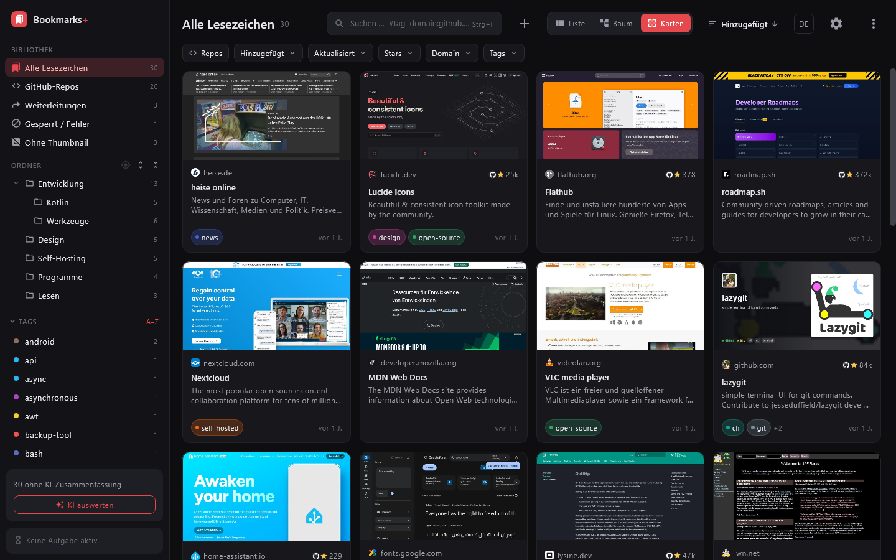
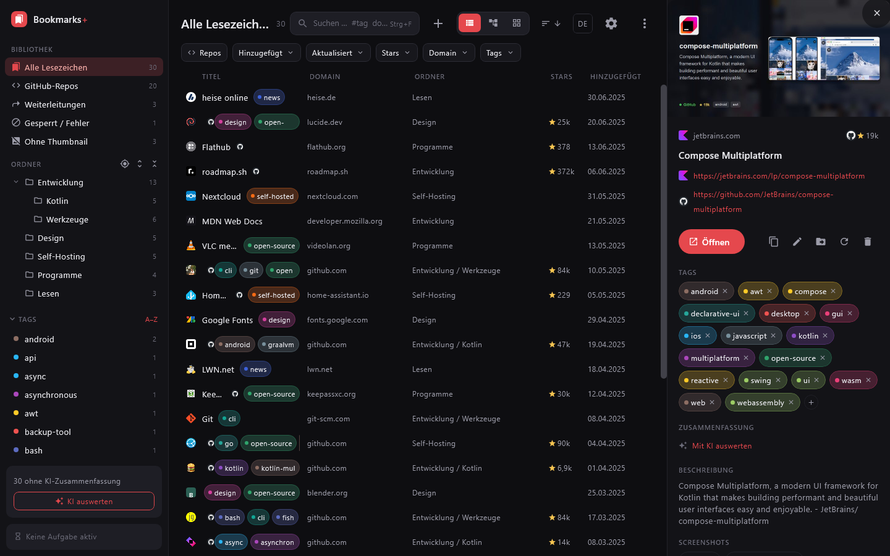
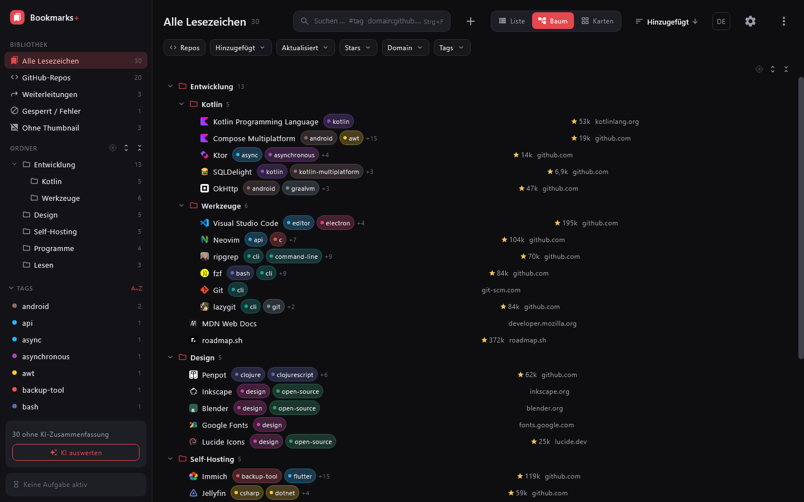
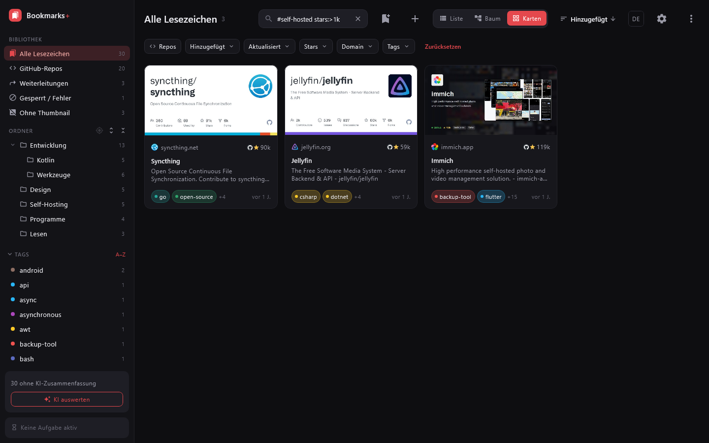
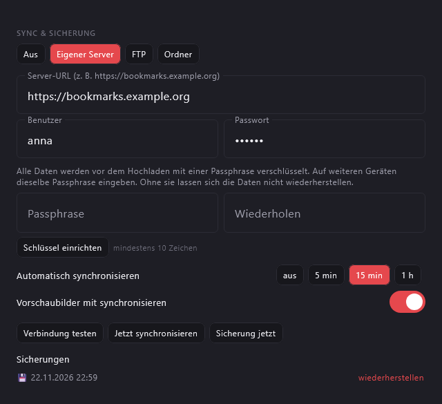
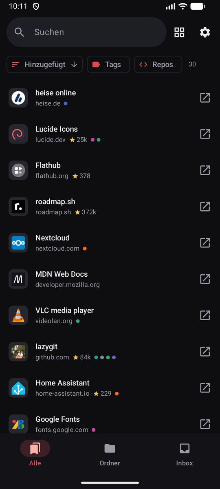
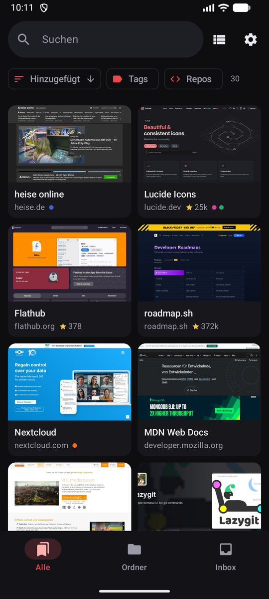
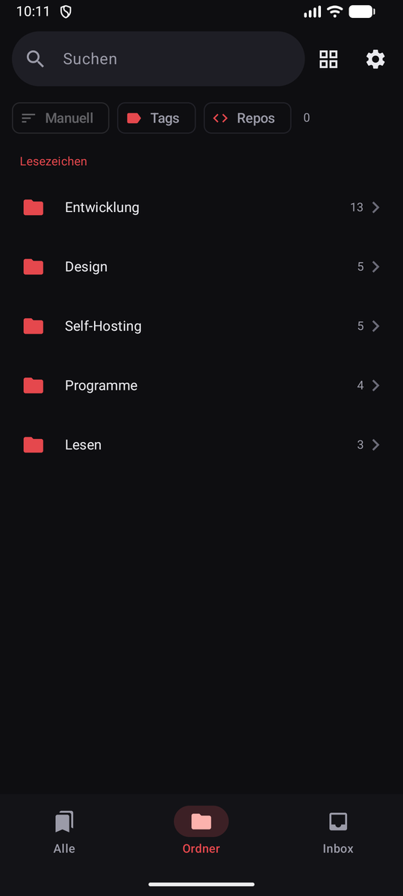
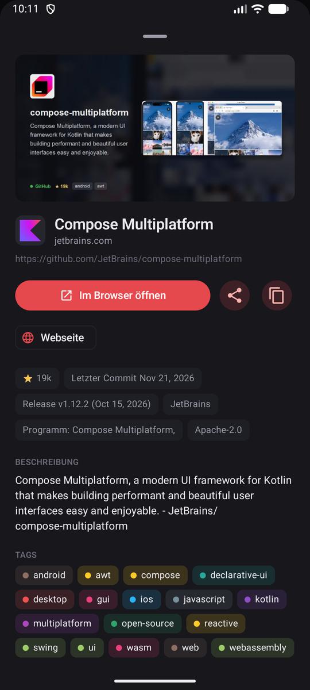
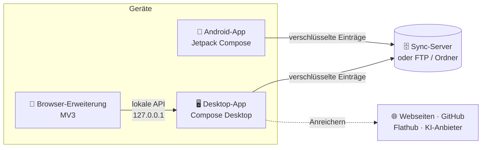

<p align="center">
  
</p>

<h1 align="center">Bookmarks Plus</h1>

<p align="center"><a href="README.md">🇬🇧 English</a> · <b>🇩🇪 Deutsch</b></p>

<p align="center">
  <b>Ordnung für Tausende Lesezeichen.</b><br>
  Ein schneller, lokaler Lesezeichen-Manager mit Vorschaubildern, GitHub-Daten, KI-Zusammenfassungen<br>
  und Ende-zu-Ende-verschlüsseltem Sync für Desktop, Android und Browser.
</p>

<p align="center">
  
  
  <a href="https://github.com/TobseF/Bookmarks-Plus/actions/workflows/build.yml"></a>
  
  
  
  <a href="LICENSE"></a>
</p>

<p align="center">
  
</p>

---

Browser-Lesezeichen stoßen schnell an Grenzen: keine Vorschau, keine Tags, träge bei ein paar Tausend Einträgen, und jeder Link liegt nur in einem Ordner. **Bookmarks Plus** ist eine native App, die mit 6.000 Lesezeichen in Millisekunden sucht und filtert. Sie reichert jede Seite lokal an und hält alles zwischen den eigenen Geräten im Gleichstand, ohne dass ein Server die Inhalte lesen kann.

## Funktionen

<table>
<tr>
<td width="50%" valign="top">

### 🗂️ Organisieren
- **Ordner und Verknüpfungen:** Ein Lesezeichen liegt in beliebig vielen Ordnern.
- **Farbige Tags**, Inbox, Papierkorb, gespeicherte Suchen
- **Drei Ansichten:** Karten, Liste und Baum
- Mehrfachauswahl, Drag & Drop, Tastenkürzel
- Import/Export im Netscape-HTML-Format: **byte-genau kompatibel** mit Chrome und Vivaldi
- Oberfläche auf **Englisch und Deutsch**

</td>
<td width="50%" valign="top">

### 🔍 Finden
- Suche in **Millisekunden** über Titel, URL, Beschreibung und **Volltext** (README, Seitentext, Zusammenfassung)
- **Relevanz-Sortierung:** Titel vor Ordnerpfad vor Tags vor sonstigen Feldern; ganze Wörter, passende Groß-/Kleinschreibung und die Anzeigesprache zuerst. Findet auch **Ordner** (Umschalter: beides, Lesezeichen, Ordner)
- **Operatoren:** `#tag` `domain:github.com` `stars:>1k` `added:2024` `is:repo` `is:dead` `-wort` …
- Filter nach Erstellt, Aktualisiert, Stars, Domain und Tags

</td>
</tr>
<tr>
<td valign="top">

### ✨ Anreichern
- **Vorschaubild** jeder Seite, lokal per Headless-Chrome, **Cookie-Banner werden ausgeblendet**
- **Share-Bilder** (`og:image`) als Card, Favicons, Metadaten
- **GitHub:** Stars, letzter Commit, Release, Autor/Organisation, komplette **README**, offizielle Webseite
- **Programme:** Plattformen, Lizenz, Paket-IDs (winget, brew …), Flathub- und AlternativeTo-Daten

</td>
<td valign="top">

### 🤖 KI (optional)
- KI-Titel, Beschreibung und **Zusammenfassung** auf Deutsch und Englisch
- Vorschläge für **Tags** und **Zielordner**, einzeln oder für viele Lesezeichen auf einmal übernehmen
- **OpenRouter**, **nano-gpt** oder eigene Base-URL (Ollama, LM Studio)
- Eigener API-Key, Kosten pro Lauf im Blick

</td>
</tr>
<tr>
<td valign="top">

### 🧹 Aufräumen
- **Duplikate** finden und zusammenführen
- **Link-Prüfung:** tot, Weiterleitung, Bot-Schutz, mit Webarchiv-Link
- Adressen auf **https** umstellen
- Papierkorb mit Wiederherstellen

</td>
<td valign="top">

### 🔐 Sync und Sicherheit
- **Ende-zu-Ende-verschlüsselt** (Argon2id + AES-256-GCM) **je Lesezeichen**
- Ziel: **eigener Server** (Docker), **FTP/FTPS** oder ein Cloud-Ordner
- Der Server sieht nur undurchsichtige UUIDs, Revision und Zeitpunkt. **Konflikte** erkennt er selbst.
- Verschlüsselter **Export** als Datei oder als ein File pro Eintrag

</td>
</tr>
</table>

## Screenshots

| Liste mit Detailbereich | Ordnerbaum |
|---|---|
|  |  |
| **Suche mit Operatoren** | **Sync-Einstellungen** |
|  |  |

**Android**

<p>
  
  
  
  
</p>

<sub>Alle Screenshots zeigen die Demo-Sammlung aus <a href="docs/demo/demo-bookmarks.html"><code>docs/demo/demo-bookmarks.html</code></a>, angereichert von der App selbst.</sub>

## Komponenten

| | Komponente | Wofür | Doku |
|---|---|---|---|
| 🖥️ | **Desktop-App** | Hauptanwendung für Windows und Linux: sammeln, sortieren, anreichern, KI, Sync | [desktop/README_DE.md](desktop/README_DE.md) |
| 📱 | **Android-App** | ansehen, suchen, im Browser öffnen, Links per *Teilen* in die Inbox legen | [android/README_DE.md](android/README_DE.md) |
| 🗄️ | **Sync-Server** | Ktor-Server für den verschlüsselten Abgleich, als Docker-Image | [server/README_DE.md](server/README_DE.md) |
| 🧩 | **Browser-Erweiterung** | Chrome, Vivaldi, Edge, Brave: speichern, Seitenpanel, Suche in der Adressleiste | [extension/README_DE.md](extension/README_DE.md) |

Gemeinsame Module:

| Modul | Inhalt |
|---|---|
| `shared` | Kotlin Multiplatform: Datenmodell, SQLDelight-Schema, Netscape-Import/-Export, Filter und Suche, Übersetzungen (`i18n`) |
| `enrich` | Seitenabruf, Screenshots (Playwright), Cookie-Banner, GitHub, Flathub, AlternativeTo, KI-Client |
| `sync` | Verschlüsselung, Sync-Engine auf Eintragsebene, Server/FTP/Ordner-Ziele, Export/Import, Sicherungen |



## Schnellstart

**Installieren:** Die aktuellen Pakete stehen bei den [Releases](https://github.com/TobseF/Bookmarks-Plus/releases).

| System | Datei |
|---|---|
| Windows | `BookmarksPlus-<version>-windows-x64.msi` (Installer) oder `…-portable.zip` |
| Linux | `bookmarks-plus_<version>_amd64.deb` oder `…-linux-x64.tar.gz` |
| Android | `BookmarksPlus-<version>.apk` |
| Server | Docker-Image oder `bookmarks-plus-server-<version>.zip` |

**Loslegen:**

1. Desktop-App starten, ⚙ → *Wartung* → **HTML importieren** (Export aus dem Browser).
2. Anreicherung starten. Vorschaubilder und GitHub-Daten laufen im Hintergrund.
3. Optional: KI-Anbieter eintragen, [Sync-Server](server/README_DE.md) aufsetzen, [Android-App](android/README_DE.md) und [Browser-Erweiterung](extension/README_DE.md) verbinden.

**Sprache:** Alle Apps starten auf Englisch. Umstellen auf Deutsch in den Einstellungen der jeweiligen App – Desktop: ⚙ → *Aussehen* → *Sprache*; Android: *Einstellungen* → *Darstellung*; Erweiterung: Optionsseite; Server: Umgebungsvariable `BMP_LANG=de`.

## Aus dem Quellcode bauen

Voraussetzung ist ein JDK 17 oder neuer. Das für die Toolchain nötige JDK 22 lädt Gradle bei Bedarf selbst. Für Android wird zusätzlich das Android SDK (API 36) gebraucht.

```bash
git clone https://github.com/TobseF/Bookmarks-Plus.git
cd Bookmarks-Plus

./gradlew :desktop:run                 # Desktop-App starten
./gradlew :android:assembleDebug       # Android-APK
./gradlew :server:installDist          # Server (server/build/install/)
./gradlew test                         # Tests (Android-Tests brauchen das SDK)
```

Stack: Kotlin 2.4, Compose Multiplatform 1.12, SQLDelight 2.4 (SQLite + FTS5), Ktor 3, Playwright, BouncyCastle (Argon2id), Gradle 9.

## CI/CD

Der GitHub-Actions-Workflow ([`.github/workflows/build.yml`](.github/workflows/build.yml)) baut bei jedem Push auf `main` und bei Pull Requests. Ein Tag der Form `v1.2.3` erstellt zusätzlich ein Release:

```bash
git tag v1.0.0 && git push origin v1.0.0
```

| Job | Ergebnis |
|---|---|
| `test` | alle JVM-Tests (shared, sync, server, enrich, desktop) |
| `desktop-windows` | MSI-Installer und portables ZIP |
| `desktop-linux` | `.deb` und portables `tar.gz` |
| `android` | signierte Release-APK |
| `server` | Server-ZIP |
| `docker` | Server-Image bauen und pushen: `edge` vom Hauptzweig, bei Releases `<version>` und `latest` |
| `release` | GitHub-Release mit allen Dateien und automatischen Release-Notes |

Die Ergebnisse jedes Laufs hängen als Artefakte am Workflow-Lauf.

**Secrets** (*Settings → Secrets and variables → Actions → Secrets*):

| Secret | Pflicht | Inhalt |
|---|---|---|
| `ANDROID_KEYSTORE_BASE64` | für signierte APKs | Keystore als Base64 (`base64 -w0 release.jks`) |
| `ANDROID_KEYSTORE_PASSWORD` | mit Keystore | Passwort des Keystores |
| `ANDROID_KEY_ALIAS` | mit Keystore | Alias des Schlüssels |
| `ANDROID_KEY_PASSWORD` | optional | Passwort des Schlüssels, falls abweichend vom Keystore-Passwort |
| `DOCKER_USERNAME` | nur für Docker Hub | Benutzer der Registry |
| `DOCKER_PASSWORD` | nur für Docker Hub | Access-Token der Registry |

**Variablen** (gleiche Seite, Reiter *Variables*):

| Variable | Pflicht | Inhalt |
|---|---|---|
| `DOCKER_IMAGE` | optional | Ziel-Image, z. B. `tobsef/bookmarks-plus-server` (Docker Hub). Ohne Angabe: `ghcr.io/tobsef/bookmarks-plus-server` |
| `DOCKER_REGISTRY` | optional | Registry-Host bei eigenem Ziel, Standard `docker.io` |

Ohne Android-Secrets wird die APK mit dem Debug-Schlüssel signiert, und der Lauf zeigt eine Warnung. Die GitHub Container Registry und das Release nutzen das eingebaute `GITHUB_TOKEN`, dafür sind keine Secrets nötig. Ein Image auf GHCR ist zunächst privat und lässt sich unter *Packages → Package settings* öffentlich schalten.

## Datenschutz

- Alle Daten liegen lokal (`~/.bookmarks-plus`). Es gibt kein Konto, keinen Cloud-Zwang und keine Telemetrie.
- Der Sync ist Ende-zu-Ende-verschlüsselt. Ein entwendeter Server-Datenbestand verrät weder Adressen noch Titel, Tags oder Ordner.
- API-Keys und Passwörter liegen geschützt (Windows: DPAPI).
- KI ist optional und nutzt den eigenen Schlüssel beim gewählten Anbieter. Mit Ollama oder LM Studio verlässt nichts den Rechner.

## Projektstatus

Entstanden als persönliches Werkzeug für eine Sammlung von rund 6.000 Lesezeichen. Planung und Entscheidungen stehen in [docs/PLAN.md](docs/PLAN.md), die Modellauswahl für die KI in [docs/AI-MODELLE.md](docs/AI-MODELLE.md).

## Lizenz

[MIT](LICENSE) © TobseF
