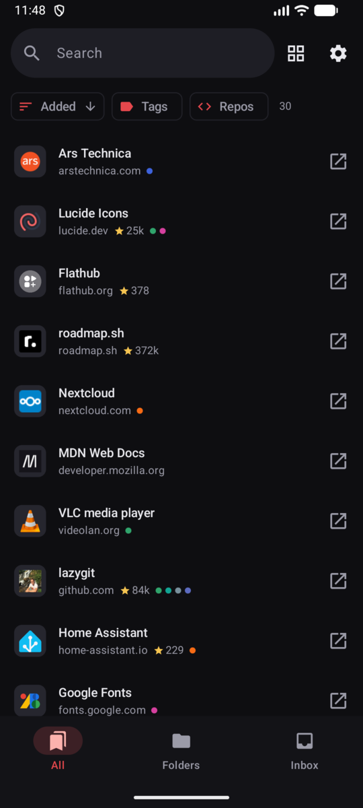
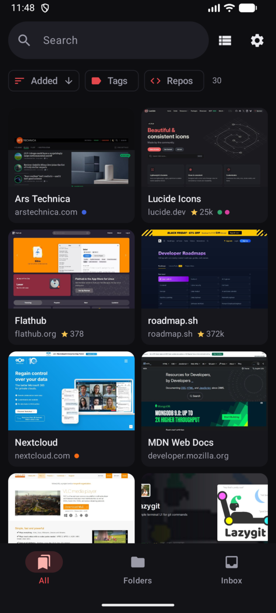
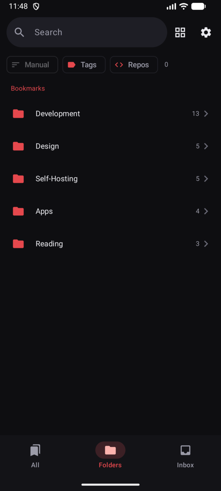
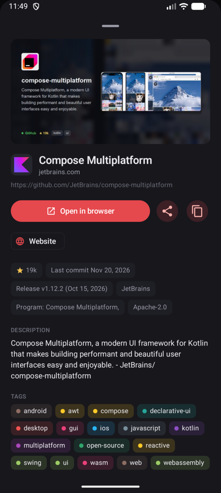

# Bookmarks Plus – Android app

<p><b>🇬🇧 English</b> · <a href="README_DE.md">🇩🇪 Deutsch</a></p>

Your bookmarks on the go: view, search, open in the browser. Links from any app can be put into the Inbox via **Share**. Enrichment, preview images and AI are handled by the [desktop app](../desktop/README.md). After the next sync the results are on the phone.

← [Back to the overview](../README.md)

<p>
  
  
  
  
</p>

## Features

- **All, Folders, Inbox:** all bookmarks, folders with path navigation, Inbox with count.
- **List or cards:** cards with the preview images from the desktop.
- **Search** with the same operators as on the desktop (`#tag`, `domain:`, `stars:>1k`, `is:repo` …), plus the full text from README and page text.
- **Sorting** (added, updated, title, domain, stars, last commit), **tag filter**, “repos only”.
- **Details** in a bottom sheet: preview, description, summary, tags, folders and GitHub data. Plus the buttons **Open in browser**, *Website*, *Repository*, *Share* and *Copy*.
- **Share → “Save to Inbox”** from the browser, YouTube, Reddit or any other app. The link is saved without a window of its own, duplicates are detected. A sync starts automatically as soon as there is network.
- **Sync** via your own server or FTP, end-to-end encrypted with the same passphrase as on the desktop. Automatically every 15 minutes to 6 hours (WorkManager), optionally only on Wi-Fi, and with pull to refresh.
- **Dark theme** with the same configurable accent color as on the desktop.
- **Language:** English (default) or German – *Settings* → *Appearance* → *Language*.

## Setup

1. Install the APK from the release (`BookmarksPlus-<version>.apk`, Android 8.0 or newer).
2. ⚙ → **Own server** (or FTP): address, user, password. Then “Test connection”.
3. Enter the same **passphrase** as on the desktop → “Set up key”. The first sync starts right away.

The first sync downloads all entries and, if enabled, the preview images: with about 6,000 bookmarks roughly 300 MB and a few minutes. After that a sync takes a few seconds. If you shared links before the first sync, nothing is lost: they are merged with the existing data, and a duplicate Inbox is combined automatically.

## Technology

- Kotlin, Jetpack Compose (Compose Multiplatform, Material 3), WorkManager.
- **The same modules as the desktop:** `shared` (data model, SQLDelight schema, search) and `sync` (encryption, sync engine). The database is the same SQLite file with FTS5 via `sqlite-jdbc`. A Gradle task places the Android libraries of `sqlite-jdbc` as `jniLibs`.
- The sync key is stored AES-encrypted in the private app storage. The app is excluded from cloud backups, data only arrives via your own sync.
- The release build only allows HTTPS. The debug build additionally allows HTTP to `10.0.2.2` and `localhost`, for a local test server from the emulator.
- UI texts: `src/main/res/values/strings_ui.xml` (English) and `values-de/strings_ui.xml` (German). The chosen language is applied independently of the system language.

## Build

```bash
./gradlew :android:assembleDebug      # android/build/outputs/apk/debug/android-debug.apk
./gradlew :android:assembleRelease    # signed, see below
```

The Android SDK (API 36) is found via `ANDROID_HOME` or `local.properties`. Version and versionCode come from `-PappVersion=1.2.3 -PversionCode=42`.

**Signing:** the release build signs with the key from these environment variables. If they are missing, it uses the debug key (for local tests).

| Variable | Contents |
|---|---|
| `ANDROID_KEYSTORE_FILE` | path to the keystore file (`.jks`) |
| `ANDROID_KEYSTORE_PASSWORD` | password of the keystore |
| `ANDROID_KEY_ALIAS` | alias of the key |
| `ANDROID_KEY_PASSWORD` | password of the key (default: keystore password) |

Create a key:

```bash
keytool -genkeypair -keystore release.jks -alias bookmarks-plus -keyalg RSA -keysize 4096 -validity 10000
```

Keep the keystore safe: updates of an installed app must be signed with the same key. `*.jks` and `*.keystore` are excluded via `.gitignore`.

## Known limitations

- `sqlite-jdbc` 3.45 is the last version with Android libraries, and they are not 16 KB aligned. On devices with 16 KB pages (Android 15 and later) the app runs in compatibility mode, the system shows a notice once.
- Editing, tagging and moving are only available on the desktop. The phone collects new links in the Inbox.
