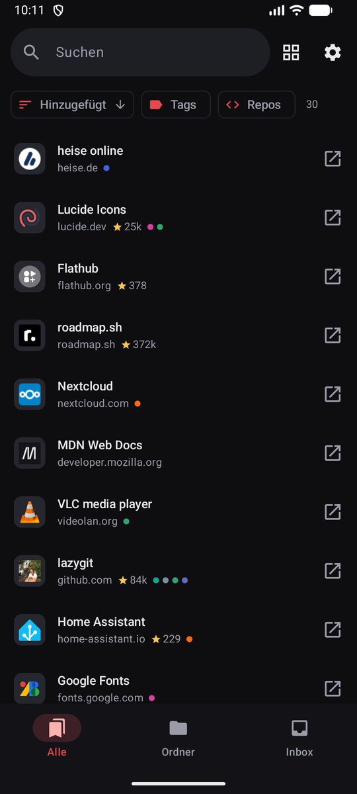
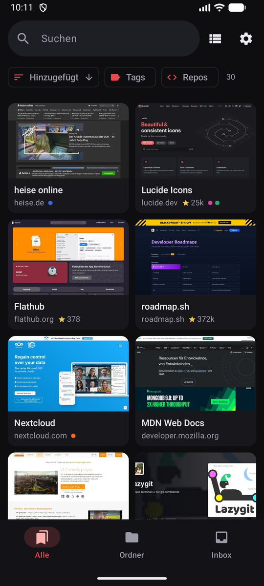
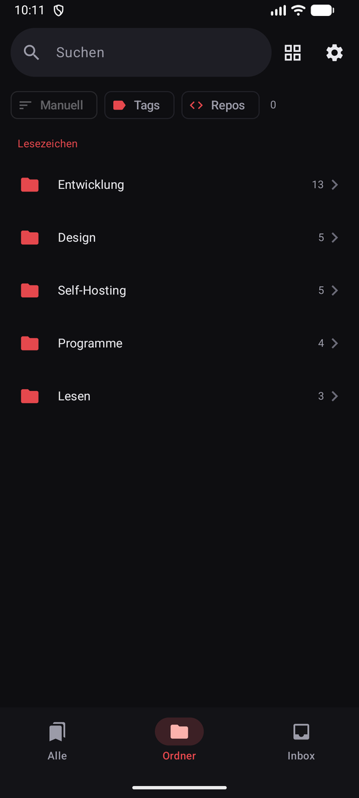
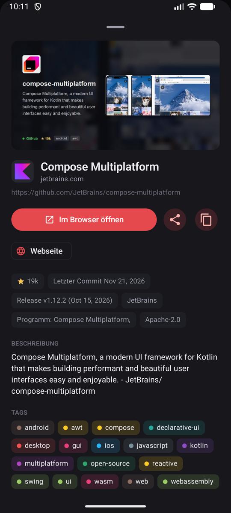

# Bookmarks Plus – Android-App

<p><a href="README.md">🇬🇧 English</a> · <b>🇩🇪 Deutsch</b></p>

Die Lesezeichen unterwegs: ansehen, durchsuchen, im Browser öffnen. Links aus jeder App lassen sich über **Teilen** in die Inbox legen. Anreichern, Vorschaubilder und KI übernimmt die [Desktop-App](../desktop/README_DE.md). Nach dem nächsten Sync sind die Ergebnisse auf dem Handy.

← [Zurück zur Übersicht](../README_DE.md)

<p>
  
  
  
  
</p>

## Funktionen

- **Alle, Ordner, Inbox:** Alle Lesezeichen, Ordner mit Pfadnavigation, Inbox mit Anzahl.
- **Liste oder Karten:** Karten mit den Vorschaubildern vom Desktop.
- **Suche** mit denselben Operatoren wie am Desktop (`#tag`, `domain:`, `stars:>1k`, `is:repo` …), dazu der Volltext aus README und Seitentext.
- **Sortierung** (hinzugefügt, aktualisiert, Titel, Domain, Stars, letzter Commit), **Tag-Filter**, „nur Repos“.
- **Details** im Bottom Sheet: Vorschau, Beschreibung, Zusammenfassung, Tags, Ordner und GitHub-Daten. Dazu die Knöpfe **Im Browser öffnen**, *Webseite*, *Repository*, *Teilen* und *Kopieren*.
- **Teilen → „In Inbox speichern“** aus Browser, YouTube, Reddit oder jeder anderen App. Der Link wird ohne eigenes Fenster gespeichert, Duplikate werden erkannt. Ein Sync startet automatisch, sobald Netz da ist.
- **Sync** über den eigenen Server oder FTP, Ende-zu-Ende-verschlüsselt mit derselben Passphrase wie am Desktop. Automatisch alle 15 Minuten bis 6 Stunden (WorkManager), optional nur im WLAN, und mit Ziehen zum Aktualisieren.
- **Dark Theme** mit derselben einstellbaren Akzentfarbe wie am Desktop.

## Einrichten

1. APK aus dem Release installieren (`BookmarksPlus-<version>.apk`, Android 8.0 oder neuer).
2. ⚙ → **Eigener Server** (oder FTP): Adresse, Benutzer, Passwort. Dann „Verbindung testen“.
3. Dieselbe **Passphrase** wie am Desktop eingeben → „Schlüssel einrichten“. Der erste Sync startet direkt.

Der erste Abgleich lädt alle Einträge und, falls eingeschaltet, die Vorschaubilder: bei rund 6.000 Lesezeichen etwa 300 MB und einige Minuten. Danach dauert ein Sync wenige Sekunden. Wer schon vor dem ersten Sync Links geteilt hat, verliert nichts: Sie werden mit dem Bestand zusammengeführt, und eine doppelt angelegte Inbox wird automatisch vereint.

## Technik

- Kotlin, Jetpack Compose (Compose Multiplatform, Material 3), WorkManager.
- **Dieselben Module wie der Desktop:** `shared` (Datenmodell, SQLDelight-Schema, Suche) und `sync` (Verschlüsselung, Sync-Engine). Die Datenbank ist dieselbe SQLite-Datei mit FTS5 über `sqlite-jdbc`. Die Android-Bibliotheken von `sqlite-jdbc` legt ein Gradle-Task als `jniLibs` ab.
- Der Sync-Schlüssel liegt AES-verschlüsselt im privaten App-Speicher. Die App ist von Cloud-Backups ausgenommen, Daten kommen ausschließlich über den eigenen Sync.
- Der Release-Build erlaubt nur HTTPS. Der Debug-Build erlaubt zusätzlich HTTP zu `10.0.2.2` und `localhost`, für einen lokalen Testserver vom Emulator aus.

## Bauen

```bash
./gradlew :android:assembleDebug      # android/build/outputs/apk/debug/android-debug.apk
./gradlew :android:assembleRelease    # signiert, siehe unten
```

Das Android SDK (API 36) wird über `ANDROID_HOME` oder `local.properties` gefunden. Version und versionCode kommen aus `-PappVersion=1.2.3 -PversionCode=42`.

**Signieren:** Der Release-Build signiert mit dem Schlüssel aus diesen Umgebungsvariablen. Fehlen sie, nimmt er den Debug-Schlüssel (für lokale Tests).

| Variable | Inhalt |
|---|---|
| `ANDROID_KEYSTORE_FILE` | Pfad zur Keystore-Datei (`.jks`) |
| `ANDROID_KEYSTORE_PASSWORD` | Passwort des Keystores |
| `ANDROID_KEY_ALIAS` | Alias des Schlüssels |
| `ANDROID_KEY_PASSWORD` | Passwort des Schlüssels (Standard: Keystore-Passwort) |

Einen Schlüssel erzeugen:

```bash
keytool -genkeypair -keystore release.jks -alias bookmarks-plus -keyalg RSA -keysize 4096 -validity 10000
```

Den Keystore gut aufbewahren: Updates einer installierten App müssen mit demselben Schlüssel signiert sein. `*.jks` und `*.keystore` sind per `.gitignore` ausgeschlossen.

## Bekannte Grenzen

- `sqlite-jdbc` 3.45 ist die letzte Version mit Android-Bibliotheken, und diese sind nicht 16-KB-ausgerichtet. Auf Geräten mit 16-KB-Seiten (ab Android 15) läuft die App im Kompatibilitätsmodus, das System zeigt einmal einen Hinweis.
- Bearbeiten, Tags setzen und Verschieben gibt es nur am Desktop. Das Handy sammelt neue Links in der Inbox.
