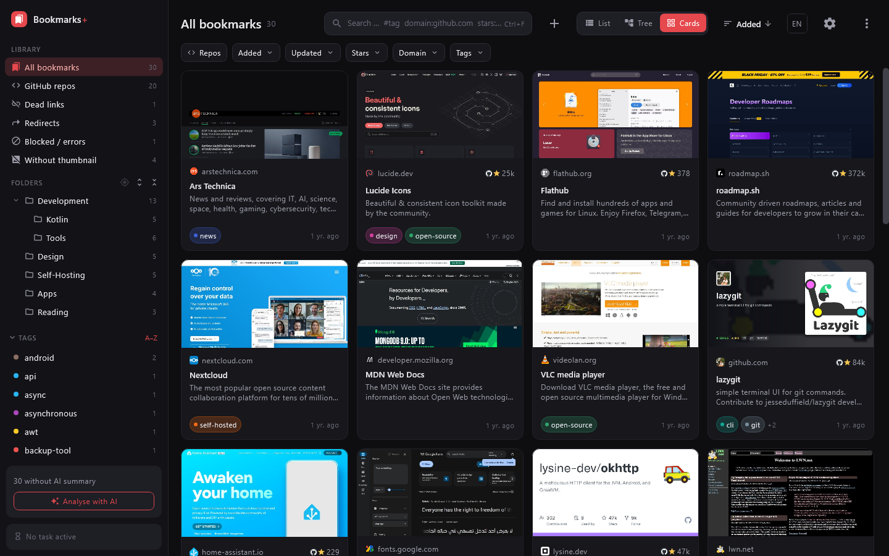
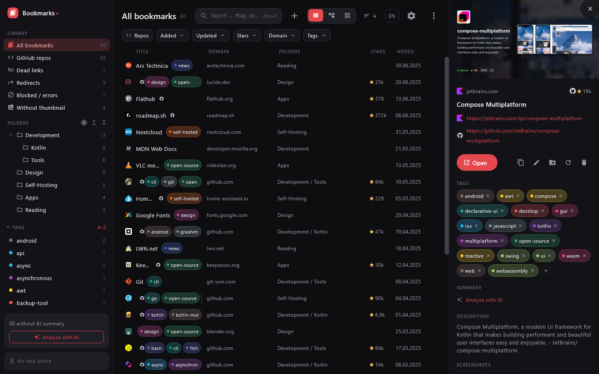
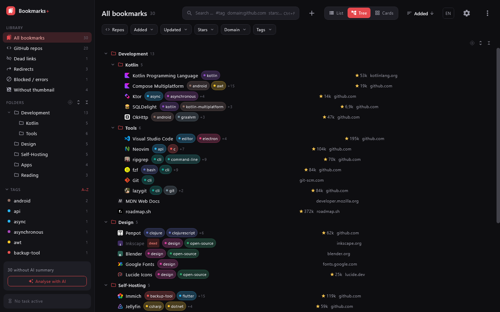
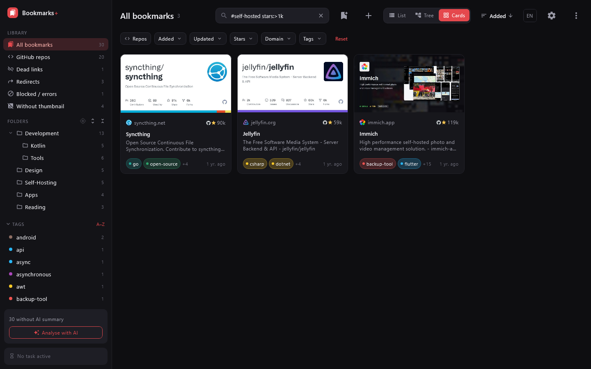
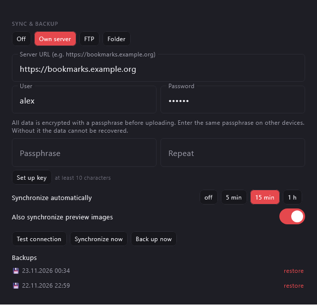

# Bookmarks Plus – Desktop app

<p><b>🇬🇧 English</b> · <a href="README_DE.md">🇩🇪 Deutsch</a></p>

The main app: a fast, local bookmark manager for Windows and Linux (macOS can be built) with Compose Multiplatform. This is where bookmarks are collected, sorted, enriched and analysed. The Android app and the browser extension feed into it.

← [Back to the overview](../README.md)



## Contents

- [Install](#install)
- [First steps](#first-steps)
- [Views and usage](#views-and-usage)
- [Search](#search)
- [Enrichment](#enrichment)
- [AI](#ai)
- [Programs and games](#programs-and-games)
- [Clean up](#clean-up)
- [Import and export](#import-and-export)
- [Sync and backups](#sync-and-backups)
- [Browser extension and local API](#browser-extension-and-local-api)
- [Data and privacy](#data-and-privacy)
- [Build and develop](#build-and-develop)

## Install

Every release contains:

| File | System |
|---|---|
| `BookmarksPlus-<version>-windows-x64.msi` | Windows installer (per user, start menu and desktop shortcut, updates replace the old version) |
| `BookmarksPlus-<version>-windows-x64-portable.zip` | Windows portable: unzip, start `BookmarksPlus.exe` |
| `bookmarks-plus_<version>_amd64.deb` | Debian, Ubuntu, Mint: `sudo apt install ./bookmarks-plus_<version>_amd64.deb` |
| `bookmarks-plus-<version>-linux-x64.tar.gz` | Linux portable: unpack, start `BookmarksPlus/bin/BookmarksPlus` |

A Java runtime is included in each. For preview images the app uses an installed **Chrome** or **Edge** (headless).

## First steps

1. **Import:** ⚙ → *Maintenance* → “Import HTML …” and choose the export file from Chrome, Vivaldi, Edge, Brave or Firefox (Netscape format). Duplicate addresses are merged into one bookmark with several folder placements. A later HTML export writes them back as copies per folder, so browsers can read it just the same.
2. **Enrich:** the hint in the sidebar starts the enrichment (preview images, metadata, GitHub data). With a few thousand bookmarks this runs in the background for a while.
3. **Optional AI:** ⚙ → *AI* → enter provider and API key, then “Analyse with AI”.
4. **Optional sync:** ⚙ → *Sync* → choose your own [server](../server/README.md), FTP or a folder and set a passphrase.
5. **Language:** the interface starts in English. ⚙ → *Appearance* → *Language* switches to German (takes effect immediately).

## Views and usage

| List with detail pane | Tree |
|---|---|
|  |  |

- **Cards, list, tree** with a shared filter bar: repos, added, updated, stars, domain, tags.
- **Sidebar:** library (all, GitHub repos, Inbox, duplicates, redirects, dead links, trash …), folder tree with counts, saved searches and colored tags.
- **Detail pane:** preview, website and repository side by side, GitHub data (stars, last commit, release, author/organization), rendered README, AI title and summary, tags, all folder placements. Editing happens here too.
- **Links:** a bookmark can live in several folders. Deleting one link keeps the others.
- **Multi-selection** (Ctrl/Shift) for tags, moving, linking, AI or trash. Drag & drop onto a folder in the sidebar moves, with Ctrl it links.
- **Dark theme** with a configurable accent color (red by default, 8 presets or your own hex value). Content in English or German.
- **Interface language:** English (default) or German.

| Key | Action |
|---|---|
| `Ctrl+F` | search |
| `Ctrl+N` / `Ctrl+V` | new bookmark (with URL from the clipboard) |
| `Ctrl+A` | select all |
| `F2` | rename |
| `Del` | move to trash (with “Undo”) |
| `Ctrl+S` / `Esc` | save / cancel editing |

## Search



The search reacts instantly, even with many thousands of bookmarks. It searches title, address and descriptions in memory and the full text (README, page text, summary) via SQLite FTS5. Operators can be combined freely:

| Operator | Example |
|---|---|
| Tag | `#kotlin` |
| Domain | `domain:github.com` |
| Stars | `stars:>1000`, `stars:500`, `stars:>1k` |
| Year added | `added:2024` |
| Kind | `is:repo`, `is:app`, `type:article` |
| State | `is:dead`, `is:redirect`, `is:blocked`, `is:duplicate`, `is:nothumb` |
| AI | `is:ai`, `is:noai`, `is:suggested` |
| Programs | `platform:pc`, `os:linux`, `has:flathub`, `has:winget`, `license:gpl` |
| Exclude | `-word` |

Every search can be stored as a **saved search** in the sidebar.

## Enrichment

Every page is fetched locally, without any cloud service:

- **Metadata:** title, description, share image (`og:image`) as card, favicon, content type, page text for the full-text search.
- **Preview image:** screenshot via Playwright with Chrome/Edge. Cookie banners are hidden (CMP hosts blocked, CSS hide list, overlay heuristics).
- **GitHub:** stars, last commit, latest release, author or organization, topics, the complete README and the official website. For GitHub projects the preview image comes from the website, the GitHub card is shown in addition. Without a token 60 requests per hour are possible, with a token (⚙ → *Enrichment*) 5,000.
- **Link check:** reachable, redirect (apply the target), dead (404/410, domain gone), blocked (bot protection), server error. Dead pages get a Web Archive link.

## AI

An OpenAI-compatible client with presets for **OpenRouter** and **nano-gpt** plus a custom base URL (Ollama, LM Studio …). The model can be chosen freely, the model list shows the prices. For each bookmark you get:

- AI title, description and summary in **English and German**
- 2–5 **tags** from a consistent vocabulary, assigned directly if you like
- a **target folder**, preselected from your own folders (local TF-IDF prefilter)

Suggestions are applied or discarded in the detail pane, also for many bookmarks at once. Tokens and costs are shown in the sidebar. A model recommendation by price and performance is in [docs/AI-MODELLE.md](../docs/AI-MODELLE.md) (German).

## Programs and games

For software bookmarks the app collects program name, platforms (PC, smartphone, browser, Docker), systems, license and package IDs (winget, Chocolatey, Scoop, Homebrew, npm). On top come Flathub data (icon, screenshots, downloads) and AlternativeTo entries. A click on a package ID copies the install command.

## Clean up

- **Duplicates** via a normalized URL, “Merge here” or all groups at once. The entry with the most data is kept, the other folders become links.
- **Inbox** for new bookmarks from the Android app, the browser extension or `Ctrl+N`. After a sync the desktop enriches them automatically.
- **Trash** with restore (including the old folder path).
- **Switch addresses to https**, **link check**, **load missing READMEs**.

## Import and export

⚙ → *Maintenance*:

- **HTML** (Netscape format), compatible with Chrome and Vivaldi. A round trip produces a byte-identical file.
- **Encrypted as a file** (`.bmpx`): the whole database (bookmarks, folders, tags, icons) with its own passphrase.
- **Encrypted as a file list:** a folder with one file `<date>_<UUID>.bin` per entry. Exporting again into the same folder only rewrites what changed and marks deletions – ideal for backups via a hoster or a cloud folder.
- **Import encrypted** merges with the existing data. Newer local changes are kept.

## Sync and backups



- **Targets:** your own [server](../server/README.md), FTP/FTPS or a local folder.
- **End-to-end encrypted** at entry level (Argon2id → AES-256-GCM). The target only sees opaque IDs, revisions and timestamps. How it works is described in the [server documentation](../server/README.md#how-syncing-works).
- Automatically every 5, 15 or 60 minutes or via the button in the top bar. Preview images can be transferred as well.
- **Backups:** daily locally (the last 7), encrypted at the target on demand (the last 10). Restoring happens on the next start.
- API keys, tokens and passwords are protected via DPAPI on Windows, otherwise AES-encrypted with a key file readable only by the user.

## Browser extension and local API

The app opens a local interface (only `127.0.0.1`, from port 47811) for the [browser extension](../extension/README.md): save, search, side panel with tree, list and tiles, search in the address bar. The extension is paired once with a code. Only a SHA-256 of the token is stored.

## Data and privacy

Everything is stored locally under `~/.bookmarks-plus/`:

| Path | Contents |
|---|---|
| `bookmarks.db` | SQLite database (bookmarks, folders, tags, icons, settings) |
| `media/` | preview images, cards and screenshots (JPEG, max. 720 px) |
| `backups/` | daily local backups |

To the outside the app only talks to the pages of your own bookmarks (enrichment), to GitHub, Flathub and AlternativeTo (if used), to the chosen AI provider (if set up) and to your own sync target.

## Build and develop

Requirement: JDK 17+ for Gradle. Gradle downloads JDK 22 for the toolchain on its own.

```bash
./gradlew :desktop:run                    # start
./gradlew :desktop:test                   # tests
./gradlew :desktop:createDistributable    # portable folder under desktop/build/compose/binaries/main/app
./gradlew :desktop:packageMsi             # Windows installer (downloads WiX automatically)
./gradlew :desktop:packageDeb             # Linux .deb (needs fakeroot and binutils)
```

The version comes from `-PappVersion=1.2.3`. Packages only contain the Playwright driver of the target system, an artifact transform removes the others (saves about 180 MB).

UI texts live in `src/main/resources/i18n/desktop.properties` (English) and `desktop_de.properties` (German); messages of the shared modules in the `i18n` folders of `shared`, `sync` and `enrich`.

More tools:

```bash
# Enrich everything and analyse it with AI, without UI
./gradlew :desktop:index --args="--key-file nano-gpt.txt --enrich --all"

# README screenshots from the demo collection (really loads the pages)
# English: docs/demo/demo-bookmarks-en.html → docs/screenshots, German: docs/demo/demo-bookmarks.html → docs/screenshots/de
./gradlew :desktop:test --tests "*DemoScreenshots*" -Ddemo.out=$PWD/docs/screenshots -Ddemo.root=$PWD
./gradlew :desktop:test --tests "*DemoScreenshots*" -Ddemo.out=$PWD/docs/screenshots/de -Ddemo.root=$PWD -Ddemo.lang=de
```

Network tests run with `-Dnet=true`. Some tests (round trip, performance, screenshots) use a real browser export as sample data. They only run if `bookmarks_20.11.26.html` is in the project folder, otherwise they are skipped. Such exports are excluded via `.gitignore`.
