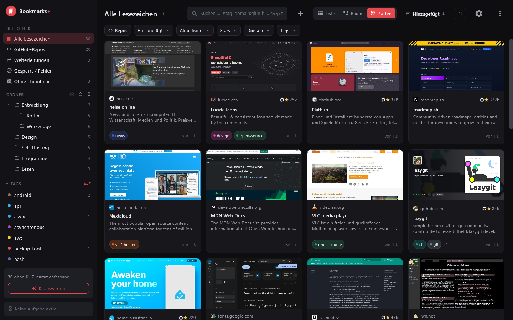
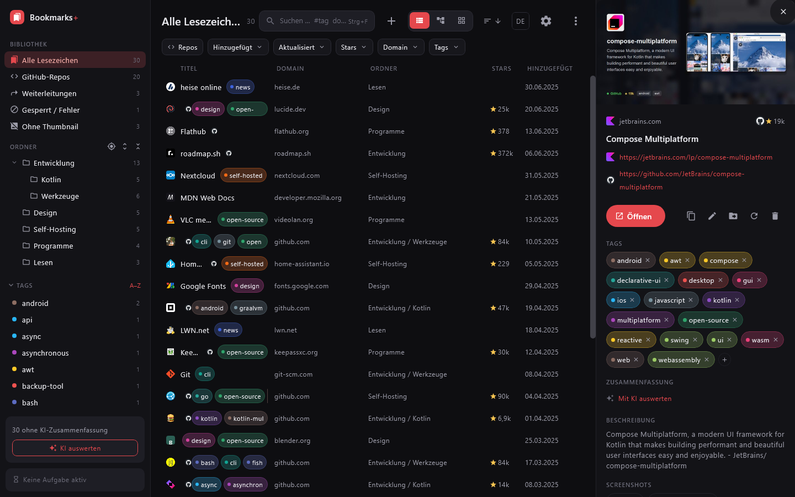
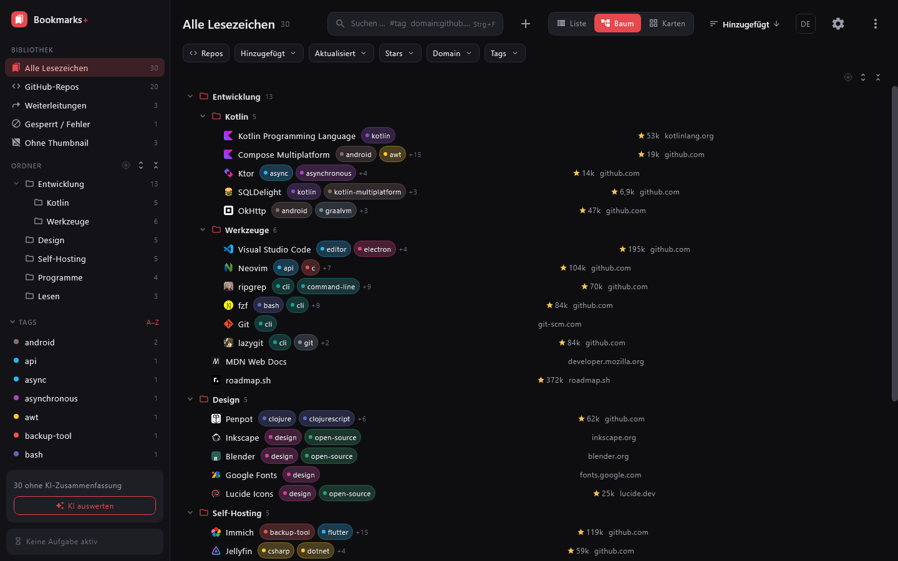
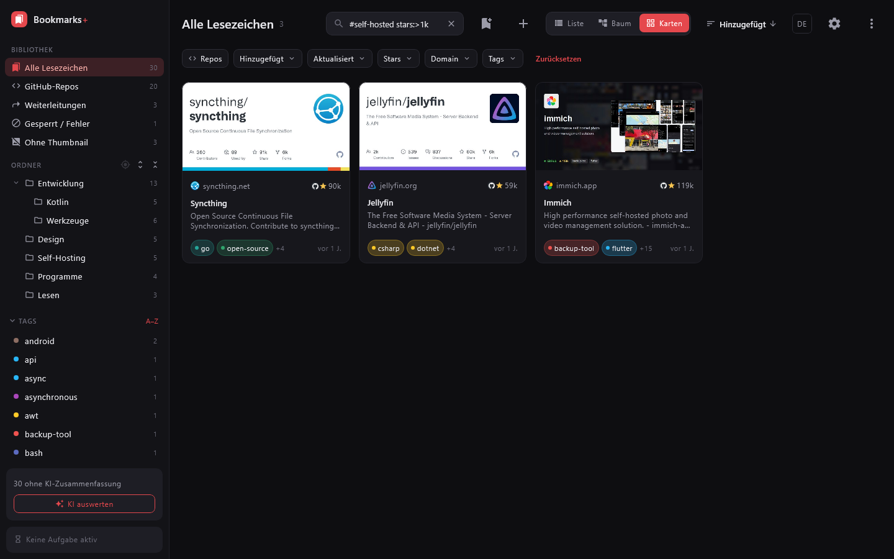
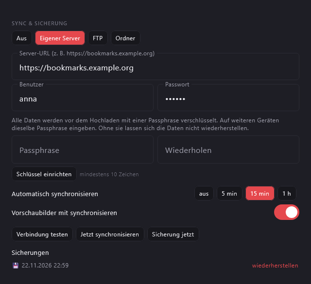

# Bookmarks Plus – Desktop-App

<p><a href="README.md">🇬🇧 English</a> · <b>🇩🇪 Deutsch</b></p>

Die Haupt-App: ein schneller, lokaler Lesezeichen-Manager für Windows und Linux (macOS lässt sich bauen) mit Compose Multiplatform. Hier wird gesammelt, sortiert, angereichert und ausgewertet. Android-App und Browser-Erweiterung arbeiten ihr zu.

← [Zurück zur Übersicht](../README_DE.md)



## Inhalt

- [Installieren](#installieren)
- [Erste Schritte](#erste-schritte)
- [Ansichten und Bedienung](#ansichten-und-bedienung)
- [Suche](#suche)
- [Anreichern](#anreichern)
- [KI](#ki)
- [Programme und Spiele](#programme-und-spiele)
- [Aufräumen](#aufräumen)
- [Import und Export](#import-und-export)
- [Sync und Sicherungen](#sync-und-sicherungen)
- [Browser-Erweiterung und lokale API](#browser-erweiterung-und-lokale-api)
- [Daten und Datenschutz](#daten-und-datenschutz)
- [Bauen und entwickeln](#bauen-und-entwickeln)

## Installieren

Bei jedem Release gibt es:

| Datei | System |
|---|---|
| `BookmarksPlus-<version>-windows-x64.msi` | Windows-Installer (je Benutzer, Startmenü und Desktop-Verknüpfung, Updates ersetzen die alte Version) |
| `BookmarksPlus-<version>-windows-x64-portable.zip` | Windows portabel: entpacken, `BookmarksPlus.exe` starten |
| `bookmarks-plus_<version>_amd64.deb` | Debian, Ubuntu, Mint: `sudo apt install ./bookmarks-plus_<version>_amd64.deb` |
| `bookmarks-plus-<version>-linux-x64.tar.gz` | Linux portabel: entpacken, `BookmarksPlus/bin/BookmarksPlus` starten |

Eine Java-Laufzeit ist jeweils enthalten. Für Vorschaubilder nutzt die App einen installierten **Chrome** oder **Edge** (headless).

## Erste Schritte

1. **Importieren:** ⚙ → *Wartung* → „HTML importieren …“ und die Export-Datei aus Chrome, Vivaldi, Edge, Brave oder Firefox wählen (Netscape-Format). Doppelte Adressen werden dabei zu einem Lesezeichen mit mehreren Ordnerplätzen zusammengeführt. Ein späterer HTML-Export schreibt sie wieder als Kopien je Ordner, sodass Browser ihn genauso lesen können.
2. **Anreichern:** Der Hinweis in der Seitenleiste startet die Anreicherung (Vorschaubilder, Metadaten, GitHub-Daten). Bei einigen Tausend Lesezeichen läuft das eine Weile im Hintergrund.
3. **Optional KI:** ⚙ → *KI* → Anbieter und API-Key eintragen, dann „KI auswerten“.
4. **Optional Sync:** ⚙ → *Sync* → eigenen [Server](../server/README_DE.md), FTP oder einen Ordner wählen und eine Passphrase festlegen.

## Ansichten und Bedienung

| Liste mit Detailbereich | Baum |
|---|---|
|  |  |

- **Karten, Liste, Baum** mit gemeinsamer Filterleiste: Repos, hinzugefügt, aktualisiert, Stars, Domain, Tags.
- **Seitenleiste:** Bibliothek (Alle, GitHub-Repos, Inbox, Duplikate, Weiterleitungen, tote Links, Papierkorb …), Ordnerbaum mit Anzahl, gespeicherte Suchen und farbige Tags.
- **Detailbereich:** Vorschau, Webseite und Repository nebeneinander, GitHub-Daten (Stars, letzter Commit, Release, Autor/Organisation), gerenderte README, KI-Titel und -Zusammenfassung, Tags, alle Ordnerplätze. Hier wird auch bearbeitet.
- **Verknüpfungen:** Ein Lesezeichen kann in mehreren Ordnern liegen. Wer eine Verknüpfung löscht, lässt die übrigen bestehen.
- **Mehrfachauswahl** (Strg/Umschalt) für Tags, Verschieben, Verknüpfen, KI oder Papierkorb. Drag & Drop auf Ordner in der Seitenleiste verschiebt, mit Strg wird verknüpft.
- **Dark Theme** mit einstellbarer Akzentfarbe (Rot als Standard, 8 Vorlagen oder eigener Hex-Wert). Inhalte auf Deutsch oder Englisch.
- **Sprache der Oberfläche:** Englisch (Standard) oder Deutsch, umschaltbar unter ⚙ → *Aussehen* → *Sprache*.

| Taste | Wirkung |
|---|---|
| `Strg+F` | Suche |
| `Strg+N` / `Strg+V` | neues Lesezeichen (mit URL aus der Zwischenablage) |
| `Strg+A` | alles auswählen |
| `F2` | umbenennen |
| `Entf` | in den Papierkorb (mit „Rückgängig“) |
| `Strg+S` / `Esc` | Bearbeiten speichern / abbrechen |

## Suche



Die Suche reagiert sofort, auch bei vielen Tausend Lesezeichen. Sie durchsucht Titel, Adresse und Beschreibungen im Speicher und per SQLite FTS5 den Volltext (README, Seitentext, Zusammenfassung). Operatoren lassen sich frei kombinieren:

| Operator | Beispiel |
|---|---|
| Tag | `#kotlin` |
| Domain | `domain:github.com` |
| Stars | `stars:>1000`, `stars:500`, `stars:>1k` |
| Jahr hinzugefügt | `added:2024` |
| Art | `is:repo`, `is:app`, `type:article` |
| Zustand | `is:dead`, `is:redirect`, `is:blocked`, `is:duplicate`, `is:nothumb` |
| KI | `is:ai`, `is:noai`, `is:suggested` |
| Programme | `platform:pc`, `os:linux`, `has:flathub`, `has:winget`, `license:gpl` |
| Ausschließen | `-wort` |

Jede Suche lässt sich als **gespeicherte Suche** in der Seitenleiste ablegen.

## Anreichern

Jede Seite wird lokal abgerufen, ohne Cloud-Dienst:

- **Metadaten:** Titel, Beschreibung, Share-Bild (`og:image`) als Card, Favicon, Content-Typ, Seitentext für die Volltextsuche.
- **Vorschaubild:** Screenshot per Playwright mit Chrome/Edge. Cookie-Banner werden ausgeblendet (CMP-Hosts blockiert, CSS-Ausblendliste, Overlay-Heuristik).
- **GitHub:** Stars, letzter Commit, letztes Release, Autor bzw. Organisation, Topics, komplette README und die offizielle Webseite. Für GitHub-Projekte stammt das Vorschaubild von der Webseite, die GitHub-Card wird zusätzlich angezeigt. Ohne Token sind 60 Abfragen pro Stunde möglich, mit Token (⚙ → *Anreichern*) 5.000.
- **Link-Prüfung:** erreichbar, Weiterleitung (Ziel übernehmen), tot (404/410, Domain weg), gesperrt (Bot-Schutz), Serverfehler. Für tote Seiten gibt es einen Webarchiv-Link.

## KI

Ein OpenAI-kompatibler Client mit Vorlagen für **OpenRouter** und **nano-gpt** sowie eigener Base-URL (Ollama, LM Studio …). Das Modell ist frei wählbar, die Modellliste zeigt die Preise. Je Lesezeichen entstehen:

- KI-Titel, Beschreibung und Zusammenfassung auf **Deutsch und Englisch**
- 2–5 **Tags** aus einem einheitlichen Vokabular, auf Wunsch direkt zugewiesen
- ein **Zielordner**, vorausgewählt aus den eigenen Ordnern (lokaler TF-IDF-Vorfilter)

Vorschläge werden im Detailbereich übernommen oder verworfen, auch für viele Lesezeichen auf einmal. Tokens und Kosten zeigt die Seitenleiste. Eine Modellempfehlung nach Preis und Leistung steht in [docs/AI-MODELLE.md](../docs/AI-MODELLE.md).

## Programme und Spiele

Für Software-Lesezeichen sammelt die App Programmname, Plattformen (PC, Smartphone, Browser, Docker), Systeme, Lizenz und Paket-IDs (winget, Chocolatey, Scoop, Homebrew, npm). Dazu kommen Flathub-Daten (Icon, Screenshots, Downloads) und AlternativeTo-Einträge. Ein Klick auf eine Paket-ID kopiert den Installationsbefehl.

## Aufräumen

- **Duplikate** über eine normalisierte URL, „Hier zusammenführen“ oder alle Gruppen auf einmal. Behalten wird der Eintrag mit den meisten Daten, die anderen Ordner werden zu Verknüpfungen.
- **Inbox** für neue Lesezeichen aus Android-App, Browser-Erweiterung oder `Strg+N`. Nach einem Sync reichert der Desktop sie automatisch an.
- **Papierkorb** mit Wiederherstellen (auch des alten Ordnerpfads).
- **Adressen auf https umstellen**, **Link-Prüfung**, **fehlende READMEs nachladen**.

## Import und Export

⚙ → *Wartung*:

- **HTML** (Netscape-Format), kompatibel mit Chrome und Vivaldi. Ein Roundtrip erzeugt eine byte-identische Datei.
- **Verschlüsselt als Datei** (`.bmpx`): die gesamte Datenbank (Lesezeichen, Ordner, Tags, Icons) mit eigener Passphrase.
- **Verschlüsselt als Dateiliste:** ein Ordner mit je einer Datei `<Datum>_<UUID>.bin` pro Eintrag. Ein erneuter Export in denselben Ordner schreibt nur Geändertes neu und markiert Gelöschtes – ideal zum Sichern über einen Hoster oder Cloud-Ordner.
- **Verschlüsselt importieren** führt mit dem Bestand zusammen. Neuere lokale Änderungen bleiben erhalten.

## Sync und Sicherungen



- **Ziele:** eigener [Server](../server/README_DE.md), FTP/FTPS oder ein lokaler Ordner.
- **Ende-zu-Ende-verschlüsselt** auf Eintragsebene (Argon2id → AES-256-GCM). Das Ziel sieht nur undurchsichtige IDs, Revisionen und Zeitpunkte. Wie das funktioniert, steht in der [Server-Dokumentation](../server/README_DE.md#wie-synchronisiert-wird).
- Automatisch alle 5, 15 oder 60 Minuten oder per Knopf in der Kopfzeile. Vorschaubilder lassen sich mit übertragen.
- **Sicherungen:** täglich lokal (die letzten 7), auf Knopfdruck verschlüsselt am Ziel (die letzten 10). Wiederhergestellt wird beim nächsten Start.
- API-Keys, Tokens und Passwörter liegen unter Windows per DPAPI geschützt, sonst AES-verschlüsselt mit einer nur für den Benutzer lesbaren Schlüsseldatei.

## Browser-Erweiterung und lokale API

Die App öffnet eine lokale Schnittstelle (nur `127.0.0.1`, ab Port 47811) für die [Browser-Erweiterung](../extension/README_DE.md): speichern, suchen, Seitenpanel mit Baum, Liste und Kacheln, Suche in der Adressleiste. Die Erweiterung wird einmalig mit einem Code gekoppelt. Gespeichert wird nur ein SHA-256 des Tokens.

## Daten und Datenschutz

Alles liegt lokal unter `~/.bookmarks-plus/`:

| Pfad | Inhalt |
|---|---|
| `bookmarks.db` | SQLite-Datenbank (Lesezeichen, Ordner, Tags, Icons, Einstellungen) |
| `media/` | Vorschaubilder, Cards und Screenshots (JPEG, max. 720 px) |
| `backups/` | tägliche lokale Sicherungen |

Nach außen spricht die App nur mit den Seiten der eigenen Lesezeichen (Anreicherung), mit GitHub, Flathub und AlternativeTo (falls genutzt), mit dem gewählten KI-Anbieter (falls eingerichtet) und mit dem eigenen Sync-Ziel.

## Bauen und entwickeln

Voraussetzung: JDK 17+ für Gradle. JDK 22 für die Toolchain lädt Gradle bei Bedarf selbst.

```bash
./gradlew :desktop:run                    # starten
./gradlew :desktop:test                   # Tests
./gradlew :desktop:createDistributable    # portabler Ordner unter desktop/build/compose/binaries/main/app
./gradlew :desktop:packageMsi             # Windows-Installer (lädt WiX automatisch)
./gradlew :desktop:packageDeb             # Linux .deb (braucht fakeroot und binutils)
```

Die Version kommt aus `-PappVersion=1.2.3`. Pakete enthalten nur den Playwright-Treiber des Zielsystems, die übrigen entfernt eine Artefakt-Transformation (spart rund 180 MB).

Weitere Werkzeuge:

```bash
# Alles anreichern und per KI auswerten, ohne Oberfläche
./gradlew :desktop:index --args="--key-file nano-gpt.txt --enrich --all"

# README-Screenshots aus der Demo-Sammlung (lädt die Seiten wirklich)
# Englisch: docs/demo/demo-bookmarks-en.html → docs/screenshots, Deutsch: docs/demo/demo-bookmarks.html → docs/screenshots/de
./gradlew :desktop:test --tests "*DemoScreenshots*" -Ddemo.out=$PWD/docs/screenshots -Ddemo.root=$PWD
./gradlew :desktop:test --tests "*DemoScreenshots*" -Ddemo.out=$PWD/docs/screenshots/de -Ddemo.root=$PWD -Ddemo.lang=de
```

Netzwerk-Tests laufen mit `-Dnet=true`. Einige Tests (Roundtrip, Leistung, Screenshots) nutzen einen echten Browser-Export als Beispieldaten. Sie laufen nur, wenn `bookmarks_20.11.26.html` im Projektordner liegt, sonst werden sie übersprungen. Solche Exporte sind per `.gitignore` ausgeschlossen.
